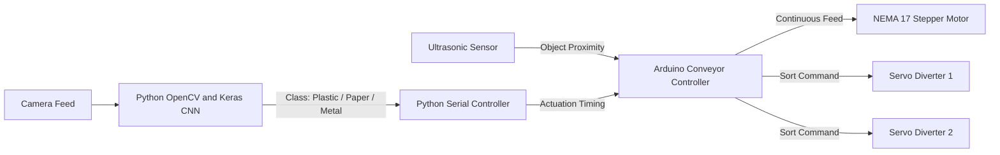

# AI Smart Trash-Sorting Conveyor Belt

> Automated industrial recycling sorter combining a Keras CNN deep learning classifier with an Arduino-driven conveyor belt, ultrasonic object tracking, and dual servo flippers.

[](https://www.arduino.cc/)
[](https://www.tensorflow.org/)
[](https://opencv.org/)
[]()
[](LICENSE)

---

## Overview

The **AI Smart Trash-Sorting Conveyor Belt** is an automated recycling testbed designed to classify and divert waste into designated categories (Metal, Paper, Plastic) in real time.

An optical camera captures waste traveling along a conveyor belt driven by a NEMA 17 stepper motor. A Convolutional Neural Network (CNN) classifies the object type, while an HC-SR04 ultrasonic sensor calculates distance and transit timing. At the designated drop zone, dual servo flippers divert the item into the correct recycling receptacle.

---

## Features

- **Trained Deep Learning Classifier**: Custom-trained Keras CNN model (`weights.keras`) optimized for distinguishing recyclable materials.
- **Precision Stepper Feed**: NEMA 17 stepper motor driven via A4988 driver for deterministic linear feed velocity.
- **Dual Mechanical Gate Diverters**: Twin high-torque micro-servos create multi-path sorting lanes (Metal vs Others, Paper vs Plastic).
- **Serial Real-Time Handshake**: Python desktop vision pipeline transmits synchronized actuation commands over Serial at 115200 baud.

---

## Hardware and Pinout

| Peripheral | Controller Pin | Role |
|---|---|---|
| **A4988 STEP Pin** | Arduino `Pin 9` | Step pulse frequency (conveyor speed control) |
| **A4988 DIR Pin** | Arduino `Pin 10` | Motor direction control |
| **A4988 ENABLE Pin** | Arduino `Pin 11` | Stepper driver enable/disable |
| **Servo 1 (Gate A)** | Arduino `Pin 5` | Diverts Metal vs Non-metal |
| **Servo 2 (Gate B)** | Arduino `Pin 6` | Diverts Paper vs Plastic |
| **Ultrasonic Trigger** | Arduino `Pin 7` | HC-SR04 Trigger |
| **Ultrasonic Echo** | Arduino `Pin 8` | HC-SR04 Echo |

---

## System Architecture



---

## Project Structure

```text
ai-conveyor-trash-sorter/
├── ai_model/                        # Deep Learning Classification Pipeline
│   ├── trash_classification.ipynb   # Model training & evaluation notebook
│   ├── weights.keras                # Trained CNN model weights
│   ├── arduino_controller.py        # Real-time inference & serial bridge
│   └── requirements.txt             # Python dependencies
├── firmware/                        # Embedded Arduino Controller
│   └── ConveyerBelt.ino             # Stepper pulse generation & servo actuation
└── README.md
```

---

## Getting Started

### 1. Python Environment Setup

```bash
cd ai_model
pip install -r requirements.txt
python arduino_controller.py
```

### 2. Flashing the Firmware

Open `firmware/ConveyerBelt.ino` in the Arduino IDE, select your Arduino Uno/Nano board and COM port, and upload.

---

## Author

**Salah Lai**
- GitHub: [@SalahLai](https://github.com/SalahLai)
- Email: salah.lai.icloud@gmail.com

---

## License

This project is open-source and licensed under the [MIT License](LICENSE).
